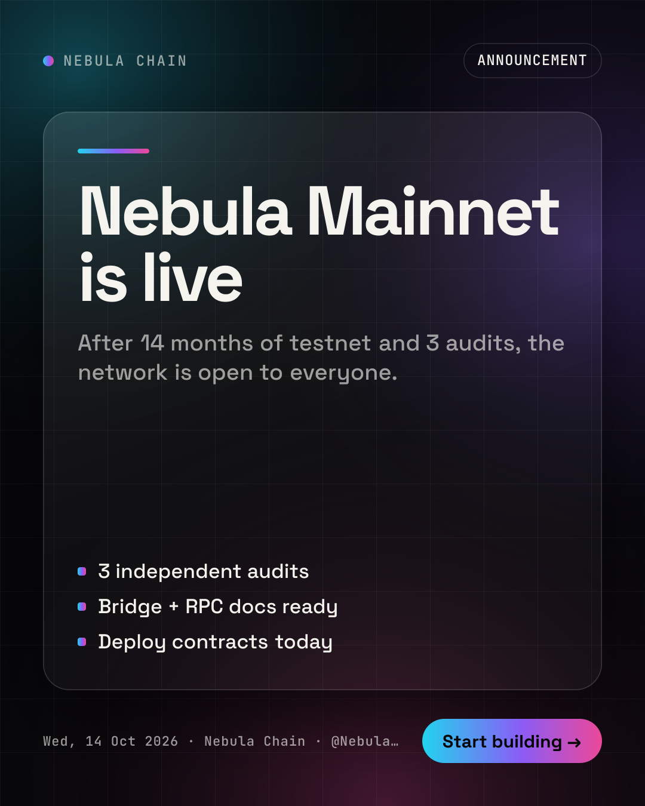
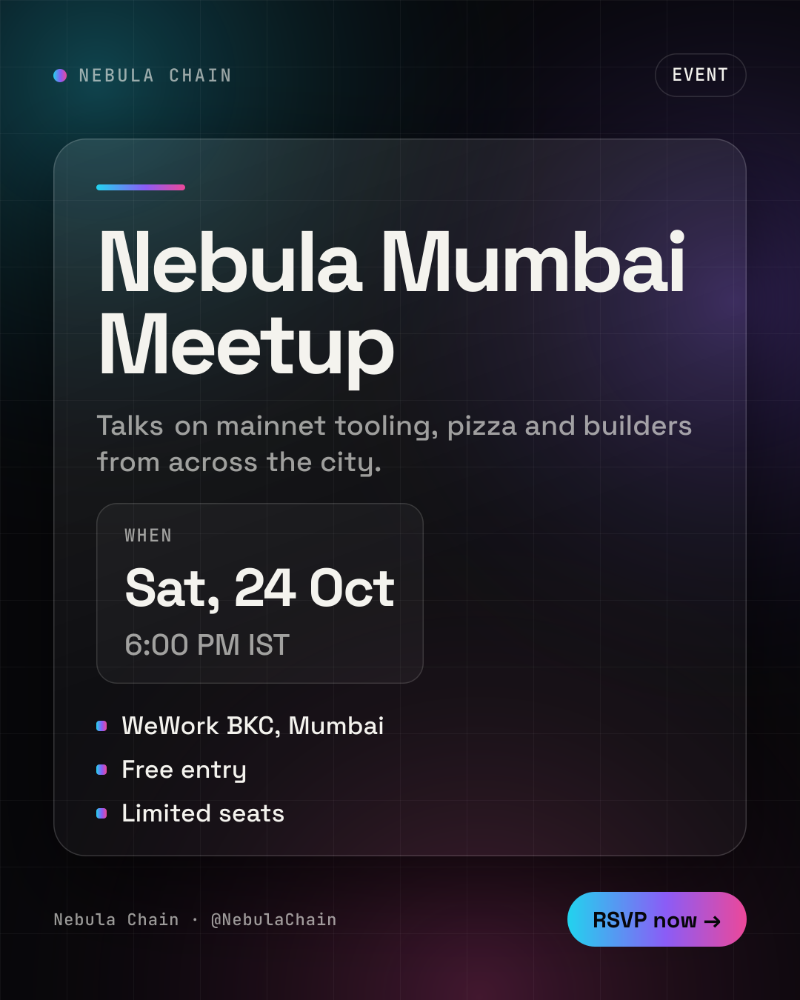
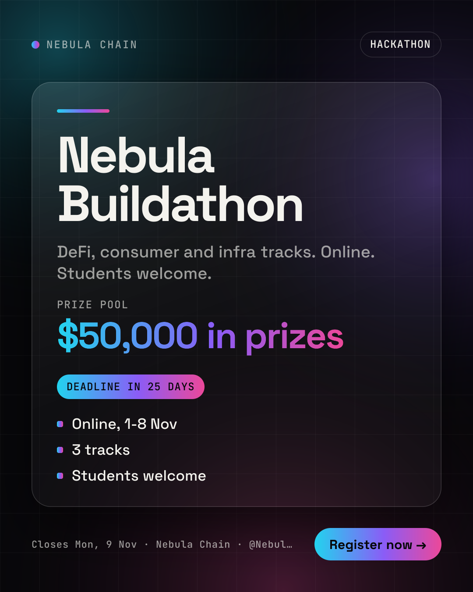
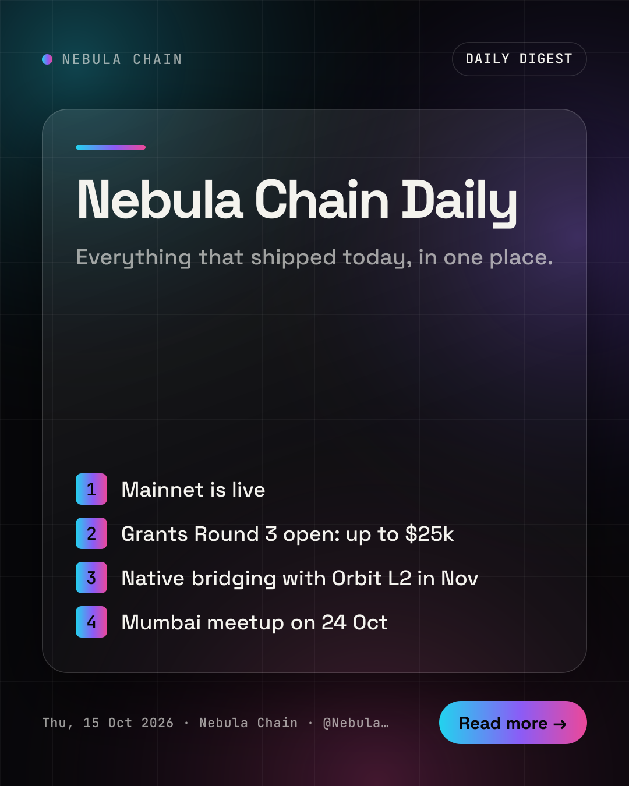
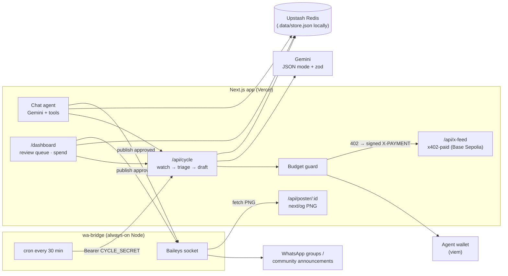

# Crier

**An autonomous WhatsApp community agent.** Crier watches X for the ecosystems your community cares about, picks what matters, writes a WhatsApp-native caption and a branded poster, waits for your approval, and publishes. It pays for its own X data, per call, from its own wallet via x402, under a hard daily budget.

Built for **Agentmaxxing × Rise In, Week 1** on the [agentmaxxin](https://www.npmjs.com/package/agentmaxxin) starter (Next.js + Google Gemini + an agent wallet on Base Sepolia).

- **Live agent:** https://crier-lovat.vercel.app (chat at `/`, review queue at [`/dashboard`](https://crier-lovat.vercel.app/dashboard))
- **Demo GIF:** `docs/demo.gif` _(to be recorded)_

## Submission status

| Area | Status |
|---|---|
| Chat agent (Gemini tool loop, 17 tools) | ✅ Done, verified live: `add_source → fetch_updates → get_spend_report`, `add_group → triage_updates → draft_post` |
| x402 paid X feed + agent wallet (Base Sepolia) | ✅ Done: unpaid call returns 402, the agent signs and pays 0.002 USDC per call, logged against the daily budget |
| Budget guard (per-call cap, daily IST cap) | ✅ Done |
| Triage, dedupe, scam guard (look-alike domains, shorteners, prompt injection) | ✅ Done: fake airdrop / free-mint fixtures are flagged |
| Captions (EN / Hinglish / Hindi) + 4 poster templates | ✅ Done |
| Review dashboard (approve / edit / reject / publish, spend card) | ✅ Done |
| Publish as share package (caption + poster + `wa.me`) | ✅ Done |
| Vercel deployment | ✅ Live at https://crier-lovat.vercel.app with Upstash Redis, full chat flow verified in production |
| wa-bridge (Baileys) | 🟡 Boots, `/health` + QR work; sending not tested end to end (needs a dedicated number) |
| Real X data (fetcher.sh x402 on Base mainnet) | ⏳ Phase 3, adapter stubbed |
| Demo GIF | ⏳ To record |

## The problem

Admins of Web3, dev-club and college WhatsApp communities run the same loop by hand every day: watch a dozen X accounts → screenshot the announcement → make a poster → rewrite a caption → post it to groups. It eats hours, and it's how phishing links slip in (fake airdrops look exactly like real launches).

## What Crier does

| Step | What happens |
|---|---|
| **Watch** | Follows X handles, Lists or search queries, grouped by ecosystem. Incremental: only posts newer than the stored cursor. One List call instead of N handle calls. |
| **Triage** | One structured Gemini call per batch classifies each post (launch, event, hackathon, grant, deadline, partnership, noise), scores relevance 0–100, merges the same news posted by several accounts, and drops replies, memes and low-relevance posts. |
| **Scam guard** | Deterministic checks on every update and every draft: links outside the source's `allowedDomains`, look-alike domains (`nebu1achain-claim.xyz`), URL shorteners, "claim airdrop" / "connect wallet" / "seed phrase" phrases, and prompt-injection text. Flagged drafts can never be auto-approved. |
| **Create** | WhatsApp-native caption (`*bold*`, bullets, IST times, ≤600 chars, ≤3 emojis, no hashtags, never invented facts) in English, Hinglish or Hindi, plus a 1080×1350 poster rendered with `next/og`. |
| **Review** | Drafts land in a review queue (dashboard or chat). Approve, edit, reject, regenerate. Human-in-the-loop by default. |
| **Publish** | Only `approved` drafts go out: through the WhatsApp bridge (rate-limited), or as a share package (caption + poster + `wa.me` link) when no bridge is configured. |
| **Pay its way** | Every X fetch is an x402 payment signed by the agent wallet, checked against `MAX_PRICE_PER_CALL_USD` and `DAILY_BUDGET_USD` *before* signing, and logged. |

### Posters

| Announcement | Event | Hackathon | Digest |
|---|---|---|---|
|  |  |  |  |

Previews live at `/api/poster/sample-<template>`; add `?stress=1` to see the overflow clamps at work.

## Architecture



Why the split: Baileys holds a long-lived WebSocket and auth files that serverless can't keep alive, and Vercel's filesystem isn't persistent, so app state goes to Upstash Redis in production.

## How x402 and the agent wallet are used

1. `fetch_updates` calls `GET /api/x-feed?ecosystem=…&since=<cursor>`.
2. The feed answers **402 Payment Required** with `{ price: "0.002", asset: "USDC", payTo }`.
3. `lib/budget.ts` reads that price **before signing** and refuses if it's over the per-call cap or would push today's (IST) spend over the daily budget.
4. Otherwise the agent wallet (viem, Base Sepolia) signs the payment, retries with `X-PAYMENT`, gets the tweets, and logs a `SpendLog` entry, shown on the dashboard and via `get_spend_report`.

Like the starter, this is the demo flavour of x402: payments are signed and verified but not broadcast on-chain. Phase 3 swaps in real x402 (USDC on Base mainnet) for live X data from twitter.fetcher.sh.

## Agent tools

`add_source` · `list_sources` · `add_group` · `list_groups` · `fetch_updates` (paid) · `fetch_tweet` (free oEmbed) · `triage_updates` · `draft_post` · `render_poster` · `list_drafts` · `review_draft` · `publish_draft` · `get_spend_report` · `run_cycle`, plus the starter's `get_weather`, `get_my_wallet` and `roll_dice`.

Try in chat:

```
Add Nebula Chain as an ecosystem, follow its List, allowed domain nebulachain.xyz
Fetch updates for Nebula Chain
Triage and draft posts for my 'Nebula India' group in Hinglish
Approve the mainnet draft and publish it
What did you spend today?
```

## Setup

```bash
npm install
cp .env.example .env      # add GEMINI_API_KEY (free: https://aistudio.google.com/apikey)
npm run dev               # http://localhost:3000, click "Create wallet"
```

Locally, state lives in `.data/store.json`. Set `UPSTASH_REDIS_REST_URL` and `UPSTASH_REDIS_REST_TOKEN` to use Redis instead.

### Deploy to Vercel

1. Push to GitHub and import the repo in Vercel (or `vercel link` + `vercel deploy --prod`).
2. Add **Upstash Redis** from the Vercel Marketplace (Storage tab, or `vercel integration add upstash/upstash-kv`) The integration sets `KV_REST_API_URL` / `KV_REST_API_TOKEN`, which the store reads (as does `UPSTASH_REDIS_REST_URL` / `_TOKEN`). Without it the app falls back to `/tmp` on Vercel, which works for a demo but is wiped between instances.
3. Set `GEMINI_API_KEY`, `GEMINI_MODEL`, `WALLET_PRIVATE_KEY` (a **test** key; the filesystem isn't persistent so "Create wallet" won't stick) and `CYCLE_SECRET`.
4. Use the **production** URL for the demo. The agent pays its own origin's `/api/x-feed`, so Deployment Protection on that URL would block the x402 call. If you protect it, add auth to the dashboard instead.

### Environment

| Var | Default | Purpose |
|---|---|---|
| `GEMINI_API_KEY` | | required |
| `GEMINI_MODEL` | `gemini-flash-latest` | chat + structured calls (`gemini-3.8-flash` recommended) |
| `GEMINI_FALLBACK_MODEL` | `gemini-flash-lite-latest` | used on 429/503/timeouts |
| `WALLET_PRIVATE_KEY` | | agent wallet (required on Vercel) |
| `X_SOURCE` | `mock` | `mock` \| `fetcher` (Phase 3) \| `official` (X API v2 + `X_BEARER_TOKEN`) |
| `DAILY_BUDGET_USD` | `0.50` | hard daily cap on x402 spend (IST day) |
| `MAX_PRICE_PER_CALL_USD` | `0.01` | refuse any single call above this |
| `RELEVANCE_THRESHOLD` | `60` | triage drop line |
| `UPSTASH_REDIS_REST_URL` / `_TOKEN` | | production store (or `KV_REST_API_URL` / `_TOKEN` from the Vercel integration) |
| `CYCLE_SECRET` | | Bearer for `POST /api/cycle` |
| `WA_BRIDGE_URL` / `BRIDGE_SECRET` | | Phase 2 bridge |
| `POSTER_AI_BACKGROUND` | `false` | Gemini image background (falls back silently) |

## wa-bridge (Phase 2)

> ⚠️ **This is an unofficial WhatsApp Web client (Baileys), not an official API. The linked number can be banned.** Use a dedicated number, never your personal one.

```bash
cd wa-bridge
npm install
cp .env.example .env     # BRIDGE_SECRET, APP_URL, CYCLE_SECRET, ADMIN_NUMBERS
npm start                # scan the QR (or set WA_PAIRING_NUMBER for a pairing code)
```

- `GET /groups` lists the groups and community announcement groups the number is in, with `isAdmin`. Copy a `jid` into the group on the dashboard, then set `WA_BRIDGE_URL` and `BRIDGE_SECRET` in the app.
- `POST /send {groupJid, caption, imageUrl}` (Bearer `BRIDGE_SECRET`) posts poster + caption after a 30–120 s jitter. It refuses groups where the number isn't admin, more than `MAX_PER_DAY` posts per group, or posts less than 20 min apart.
- Every 30 min it calls `/api/cycle?publish=1`, then DMs new drafts to `ADMIN_NUMBERS`. Reply to a draft with `1` (approve), `2` (reject) or `edit: <caption>`. Flagged drafts need an extra `confirm`.
- It never messages anyone except configured admins and the mapped groups. Auth lives in `wa-bridge/auth/` (gitignored; mount a volume on Railway, Render or Fly).
- Sending goes through a `WhatsAppSender` interface, so an official provider can replace Baileys later. Meta's Cloud API Groups API currently caps groups at 8 participants and needs an Official Business Account, so it can't serve community broadcasts yet.

## Safety model

- Tweets are untrusted data: they reach Gemini only inside `<untrusted_…>` blocks, and nothing fetched can change config, sources or budgets (budgets are env-only).
- Nothing is sent unless a draft is `approved`. Flagged drafts need explicit admin confirmation and are never auto-approved.
- Every structured LLM call uses Gemini JSON mode + a response schema, validated with zod. On a parse failure it retries once, then marks the item `error`.

## Roadmap

- **Phase 2:** wa-bridge on an always-on host, scheduler, auto-send, approval over WhatsApp DM (code in `wa-bridge/`, needs a dedicated number to go live).
- **Phase 3:** real X data via fetcher.sh x402 on Base mainnet under budget caps, daily digests per group, multi-group routing, engagement analytics, and an optional, clearly labelled sponsor slot paid via x402.

See [`NOTES.md`](NOTES.md) for deviations from the build prompt.

## Submission blurb

> **Crier** is an autonomous WhatsApp community agent: it watches X for your ecosystems, triages and de-duplicates news, flags scams, and drafts WhatsApp-native captions with branded posters.
> Admins approve in a review queue (or over WhatsApp DM) and Crier publishes to groups and community announcement channels.
> It pays for its own X data per call via x402 from its agent wallet on Base Sepolia, under a hard daily budget it can't exceed.

MIT licensed. See [LICENSE](LICENSE).
